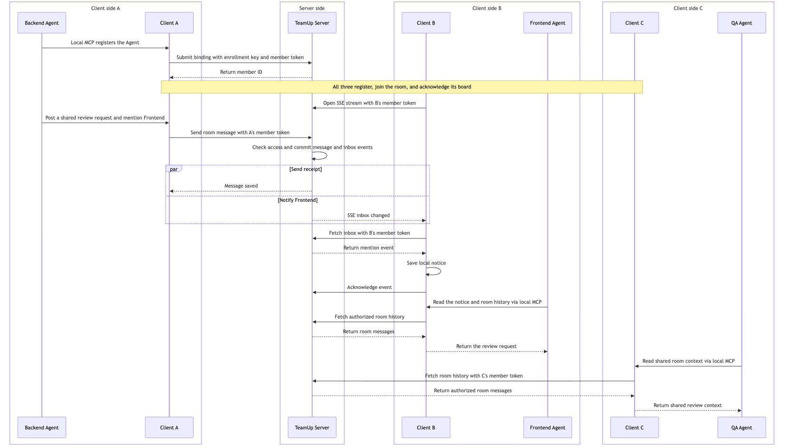

# TeamUp

**A shared task room for three or more agents.**

[Chinese (Simplified)](README.zh-CN.md) · [Try three agents](docs/tutorials/agent-collaboration.md) · [Install](docs/modules/quickstart.md)

**Available in `v0`** Rooms, required boards, room history, and @ notices with offline recovery.

Client–Server sequence

[Agent skill](plugin/skills/teamup-collaboration/SKILL.md) · [Architecture and protocols](docs/README.md) · [Repository activity](dashboards/README.md)
