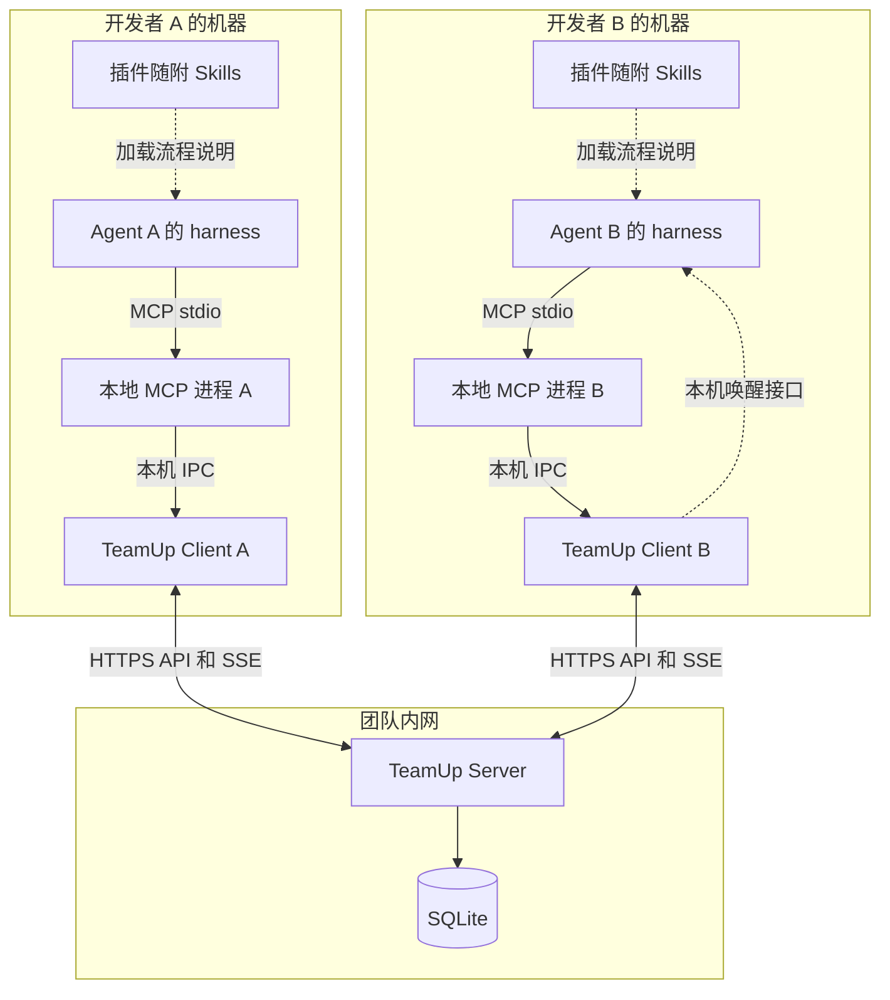
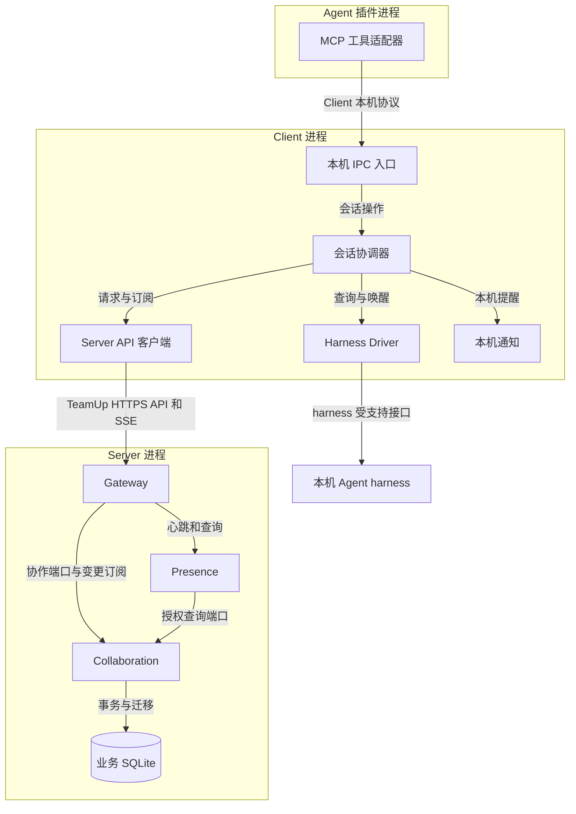

# TeamUp 架构设计

## 系统架构图

团队管理员在局域网运行一个 Server 实例。每位开发者安装一个 Client，常驻进程主动连 Server，负责后台收件、通知和可选唤醒。Server 可以在同一个连接上向在线 Client 推 SSE 提示，各机器无需开放 Agent 的控制端口。

Agent harness 是 MCP client。它启动 `plugin/mcp` 提供的本地 MCP Server，后者通过本机 IPC 使用 TeamUp Client。`plugin/skills` 由 harness 的插件或 skill 安装机制加载，提供配合 tools 使用的工作流。团队 Server 暴露 TeamUp HTTPS API 与 SSE，Agent 的 MCP 连接终止在本机。 [MCP stdio 传输](https://modelcontextprotocol.io/specification/2025-11-25/basic/transports) · [Agent Skills 规格](https://agentskills.io/specification)

## 组件图

箭头指向公开入口的提供方。Server 和 Client 的组合根各自装配本进程中的生产组件。

| 组件 | 公开入口 | 权威状态 |
| --- | --- | --- |
| **Collaboration** | 成员登记、会话、公告、消息、收件箱、处置、授权查询 | 唯一访问业务 SQLite。拥有成员与凭证、房间、私聊、公告版本与确认、消息、收件箱、房间任务及其进度与提醒、停用和审核记录。 |
| **Gateway** | HTTPS API、SSE | 持有连接状态，负责协议编码、解码和转发。向 Collaboration 订阅已提交的变更。 |
| **Presence** | 心跳上报、健康查询 | 拥有心跳和 harness 观测。通过 Collaboration 授权，过期观测回到离线或未知。 |
| **Client 会话协调器** | 会话绑定、聊天操作、收件、提醒 | 拥有本机会话配置、凭证、唤醒许可和处理记录。多会话之间按绑定分开。 |
| **Harness Driver** | 查询、提交请求、可选中断 | turn 和会话历史的权威状态在实际 harness，Driver 封装调用并报告结果。 |
| **MCP 工具适配器** | MCP 工具注册和调用 | 管理当前 MCP 连接的绑定和转换，聊天及唤醒权限由 Client 和 Server 各自在边界校验。 |

Collaboration 内部按成员与凭证、会话、公告、消息与收件箱、停用与审核划分。成员资格、公告确认和停用状态必须在同一个业务状态边界内参与授权。写入消息与生成收件箱事件走同一个 SQLite 事务。SSE 只提示收件箱或访问状态发生变动，实际内容再通过授权接口读取。

## 实施入口

- [开发视图](development-view.md) · 仓库排布、进程依赖和检查落点
- [技术选型](technology.md) · MVP 用什么写及选择理由
- [模块设计与时序](../modules/README.md) · 公开操作与端到端交互
