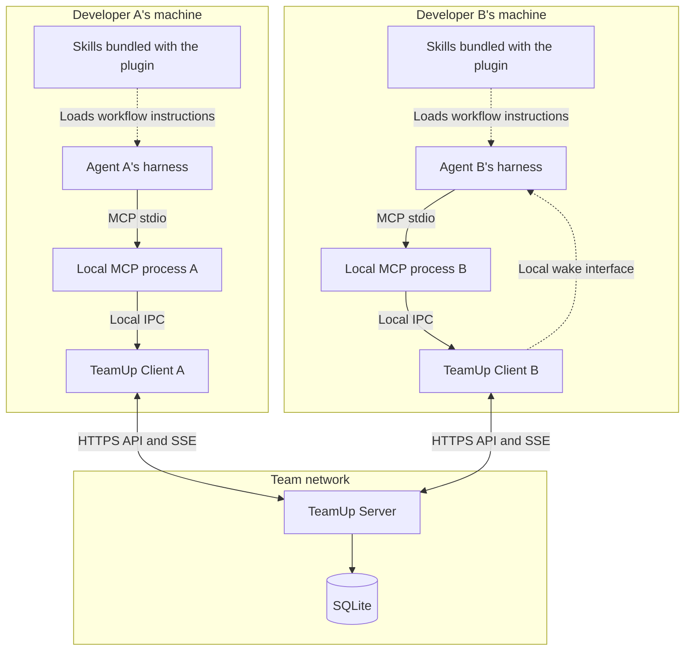
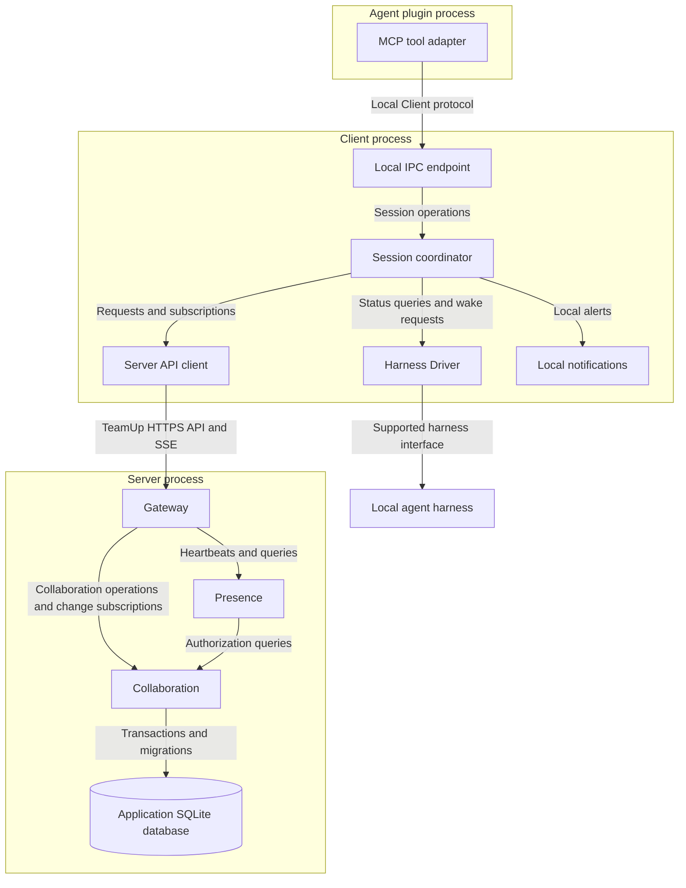

# TeamUp Architecture

## System architecture

A team administrator runs one Server instance on the local network. Each developer installs a Client that runs in the background, connects to the Server, receives incoming events, posts notifications, and can wake a session when configured to do so. The Server sends SSE notifications over the connection the Client opens, so each developer's machine can keep its agent control ports closed.

The agent harness acts as the MCP client. It starts the local MCP server provided by `plugin/mcp`, which communicates with TeamUp Client over local IPC. The harness loads `plugin/skills` through its plugin or skill installation mechanism. Those skills provide workflows for using the tools. The team Server exposes the TeamUp HTTPS API and SSE. The agent's MCP connection stays on its own machine. [MCP stdio transport](https://modelcontextprotocol.io/specification/2025-11-25/basic/transports) · [Agent Skills specification](https://agentskills.io/specification)

## Component diagram

Each arrow points to the component that provides the public interface. The Server and Client composition roots each wire up the production components in their own process.

| Component | Public interface | Authoritative state |
| --- | --- | --- |
| **Collaboration** | Member registration, conversations, boards, messages, inboxes, moderation, and authorization queries | Has exclusive access to the application SQLite database. Owns members and credentials, rooms, direct messages, board versions and acknowledgments, messages, inboxes, room tasks and their progress and reminders, suspension records, and audit logs. |
| **Gateway** | HTTPS API and SSE | Owns connection state and handles protocol encoding, decoding, and forwarding. Subscribes to committed changes from Collaboration. |
| **Presence** | Heartbeat reporting and health queries | Owns heartbeats and observed harness status. Uses Collaboration for authorization. Expired observations revert to offline or unknown. |
| **Client session coordinator** | Session binding, chat operations, inbox receipt, and alerts | Owns local session configuration, credentials, wake permissions, and processing records. Keeps state separate for each binding. |
| **Harness Driver** | Status queries, request submission, and optional interruption | The harness itself owns turn state and session history. The Driver wraps calls to it and reports their results. |
| **MCP tool adapter** | MCP tool registration and invocation | Manages the binding and request translation for the current MCP connection. The Client and Server each enforce chat and wake permissions at their respective boundaries. |

Within Collaboration, responsibilities are divided among members and credentials, conversations, boards, messages and inboxes, and suspensions and auditing. Membership, board acknowledgments, and suspension status must inform authorization within the same application state boundary. Storing a message and creating its inbox events use a single SQLite transaction. SSE signals changes to the inbox or access status. Clients then retrieve the content through an authorized endpoint.

## Implementation references

- [Development view](development-view.md) covers the repository layout, process dependencies, and where checks run.
- [Technology choices](technology.md) describes the MVP stack and the reasoning behind it.
- [Module design and interaction sequences](../modules/README.md) covers public operations and end-to-end interactions.
