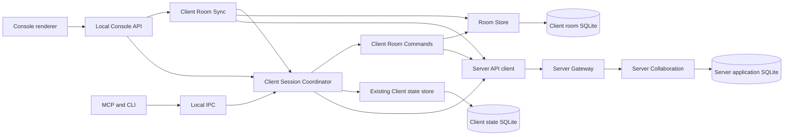

# Client local storage and synchronization

**Status — approved for staged implementation on 2026-11-28.** This design covers session reconciliation, durable room command submission, and a Client-owned room projection. The [room synchronization contract](../modules/room-sync.md) defines the wire formats and staged rollout. The [Client–Server](../modules/client-server-v1.md), [member lifecycle](../modules/member-lifecycle.md), [room tasks](../modules/room-tasks.md), and [Local Client Console](../modules/client-console.md) contracts continue to govern existing operations.

## Components and ownership

The Client owns local session approval, wake policy, and pending user or agent intent. Server Collaboration owns registered identities, room membership, authorization, and committed collaboration records. The Console renders the Client's authorized projection. The originating Client and its peers consume the same committed room changes.



| Component | Public responsibility | SQLite ownership |
| --- | --- | --- |
| **Client Session Coordinator** | Approve a local session, resolve its active binding, reconcile registration and retirement, and report when a binding becomes unusable. It continues to control local delivery and wake behavior. | Through the existing Client state store, owns session approval, credentials already kept there, retirement records, and wake policy. Add the last confirmed member association and pending retirement intent to that store. Existing notification and delivery records keep their own operations and lifetime. |
| **Client Room Sync** | Expose an authorized room view, catch up on committed changes, and invalidate views when access changes. | Owns the lifecycle of local projection records through the Room Store interface. |
| **Client Room Commands** | Persist and submit commands for a verified binding, capture preconditions, and reconcile receipts or unknown outcomes. | Owns the lifecycle of durable command records through the Room Store interface. |
| **Room Store** | Load a scoped view, persist an intent or receipt, apply a change batch, replace a baseline, and invalidate a scope. | Sole access to the room SQLite file. Owns its schema, migrations, transactions, and cache eviction. |
| **Server Collaboration** | Resolve the actor, enforce room and task rules, commit commands, and serve authorized snapshots and changes. | Sole access to the Server application database. The proposed room change records and command receipts live alongside the canonical records so they can commit together. |
| **Console, IPC, Gateway, Server API client** | Translate their respective interfaces. The Console can show a pending operation, and IPC identifies its caller through the existing binding checks. | No access to either room database. |

Room Sync, Room Commands, and Room Store belong inside `client/shared/src/teamup_client/`. The Client's `main.py` opens the stores and wires the components through their interfaces. Room Sync depends on the coordinator's binding interface and the Server transport. Room Commands receives a captured verified binding and a revision check. The coordinator invalidates views through an injected callback when the binding changes. SQLite adapters neither make network requests nor decide which rows a caller is allowed to see.

### Client room database

Use a separate private, per-profile file alongside the existing Client state database. The table names below describe ownership and keys. SQL and connection details belong to the Room Store.

| Logical table | Key and contents | Lifetime |
| --- | --- | --- |
| `room_scopes` | Server profile, account, confirmed member, room, and `membership_id`. Holds the Server generation, Board version, sync cursor, baseline coverage, and local revision. | Replaced on a new baseline. Removed on permanent loss of the scope. |
| `room_metadata`, `room_roster`, `room_messages`, `room_tasks` | Authorized rows keyed by scope and entity ID. The Board is a versioned part of room metadata. Task rows keep their Server version. | Bounded and rebuildable. Eviction drops these rows and their coverage together. |
| `room_commands` | Operation ID, bound actor and Server generation, command kind, immutable target and parameters, required versions, state, and any confirmed receipt. | Durable across process restarts and projection rebuilds. Kept separately from projection rows so a cache reset cannot discard a pending write. |

A completed command retains a compact receipt and drops its submitted text. On permanent loss of access, remove the affected projection and discard private command payloads for that scope, retaining enough information to show that the operation was blocked or its outcome is unknown. Credentials stay with the session owner. Presence stays an expiring in-memory observation. The room directory, global member directory, DMs, and retired archives keep their own authorized read paths. Room records reference member IDs. Display names, sender retirement labels, and time-derived task stall status refresh through the existing authorized member, history, and task reads. Room-specific roles and Board acknowledgments are part of the room projection.

### Server application database

Collaboration keeps the existing canonical member, room, membership, Board, message, task, and inbox records. The new records below belong to that same owner.

| Logical table | Key and contents | Lifetime |
| --- | --- | --- |
| `room_membership_revisions` | Room and member pair, with a revision advanced on each join or departure. A previously absent pair starts at revision zero. | Survives departure and rejoin, including while no membership row exists. |
| `room_changes` | Ordered commit position, room, collection, entity ID, and information needed to authorize a removal. | Bounded by change-log retention. Clients behind the retained range reset from a baseline. |
| `room_command_receipts` | Server generation, actor member, operation ID, normalized command fingerprint, and compact committed result. | Independent of message and change-log retention. See the command contract below. |
| Server generation | A single opaque value owned by Collaboration. | Stable across an ordinary restart and rotated before a restored or replaced database returns to service. |

## Session reconciliation contract

The Client identifies a harness session and durably records its stable binding and approval before enrollment. The Server binds `(owner_id, harness_instance_id, session_key)` to a `member_id` and credential. The proposed Client association stores the Server profile, account, binding, and last confirmed `member_id`. It uses a local binding revision to detect changes during in-flight work. A Client installation ID may help diagnostics. The authenticated member determines the actor.

| Observation or command | Proposed result |
| --- | --- |
| First approved registration | Use the existing enrollment request. Persist the returned association before permitting room sync or dispatch for the binding. A lost enrollment response is resolved by reading or retrying the same binding with the same credential. |
| Reconnect with the same binding and member | Verify the member through the existing member read and resume the binding. A changed Server generation invalidates room cursors and blocks replay of commands from the previous generation until reviewed. |
| Explicit retirement | Persist an intent for the confirmed member and suspend local dispatch for that binding. For durable self-retirement, extend the existing route to accept the expected member ID and Server generation and verify both in the retirement transaction. The owner route already names the target member and must also check the expected Server generation when used for durable replay. On confirmation, archive the association locally and invalidate its room scopes. |
| Lost retirement response or retirement elsewhere | Use the retirement lookup with the old member credential. The durable route variant returns the member ID and Server generation from the same authorized read. Validate both before reconciling the pending intent. A lookup can confirm the member's current retirement but cannot attribute that retirement to a particular attempt. A receipt for the captured generation resolves a specific reported success. A lookup from another generation cannot resolve the earlier attempt. A network failure or generic authorization failure leaves the outcome unresolved and access suspended. |
| Previously confirmed member is missing or returned under another ID | Mark the binding inconsistent, advance its revision, and suspend room sync, replay, and wake delivery. Hide its old projections and retain the previous association for diagnosis. Recovery must verify the original identity or explicitly create a replacement binding. Pending operations stay with their captured actor. |
| Deliberate replacement | Register a new binding using the existing migration flow. Keep the old identity and attribution until explicitly retired. The new binding starts with its own room memberships, Board acknowledgments, and cursors. |

Before sending a command or releasing a read, the Client checks the binding revision captured at the start of the operation. Local retirement, approval revocation, or account switch advances that revision and hides the affected views. Approval revocation or an observed member mismatch blocks replay and removes private payloads from the affected outbox. Reapproval or confirmation of the original member leaves that work blocked. An already dispatched request may have committed at the Server. Its late response cannot reactivate a local binding or make a private view visible. Reconcile any such result only in the original scope. See the existing [registration contract](../modules/client-server-v1.md#operations), [retirement receipt and lookup](../modules/member-lifecycle.md#identity-retirement), and [binding migration guide](../../client/README.md).

On upgrade, an active legacy binding without a stored member association uses its existing credential to read the Server's current member. The first successful read seeds the association. If the Server reports no member for a binding without a stored association, the existing explicit registration call confirms first enrollment. Reconnect and ordinary reads never enroll a member. An approved binding with a stored association can resume only after the Client verifies the original member.

## Room command contract

The Console or MCP submits a typed command through the Client. The Client resolves the actor and captures the required preconditions, persists one immutable intent, then dispatches it. The pending operation can appear in that Client's UI. A pending join does not grant local access, and a pending Board acknowledgment does not unlock a transcript.

Proposed transport is `POST /v1/room-commands` with the member bearer. A request contains a Client-generated UUID `operation_id`, `expected_member_id`, the last confirmed opaque `server_generation`, a command `kind`, and the parameters below. Room creation omits `room_id`. All other commands name the target room. The bearer authenticates the actor. The expected member, generation, and membership are preconditions.

| Command | Additional parameters and rule |
| --- | --- |
| `create_room` | Existing name, history policy, and initial Board fields. Return the assigned room and membership IDs. |
| `join_room` | Expected membership revision for the actor's room membership slot, including when absent. Read it from a proposed member-authenticated `GET /v1/rooms/{room_id}/membership-state` authorized under current room-discovery rules. Collaboration increments the revision on each join and removal, including changes through existing routes. A stale join cannot re-create a membership after an intervening join and leave. |
| `leave_room`, `remove_member` | Current actor membership ID. Removal also carries the target member and target membership IDs and the expected leadership epoch. Apply the existing leader and departure rules. A commit affects exactly the specified membership. |
| `publish_board`, `acknowledge_board` | Current actor membership ID and the Board version the edit was based on or the member actually read. Publication includes both Board sections and the expected leadership epoch. The existing explicit Board fetch remains the prerequisite for acknowledgment. |
| `send_message` | Current actor membership ID, expected Board version, existing message retry key, text, and mention targets. |
| `create_task`, `join_task`, `record_task_progress`, `finish_task` | Current actor membership ID, expected Board version, and existing task parameters and retry keys where defined. Collaboration enforces task visibility, participation, and terminal state. Concurrent eligible joins and independent progress can commit. A new progress command after finish conflicts. |

For example, a pending send records the exact Board and membership observed when the Client accepted the intent.

```json
{
  "operation_id": "0aeb179a-1443-40e7-b4eb-ff41fbe0ff0d",
  "expected_member_id": "2beedfef-7999-48a3-be7f-52770ee78a1d",
  "server_generation": "generation-token",
  "kind": "send_message",
  "room_id": "a1d48297-2f64-493f-ab2f-ddbf77594e83",
  "parameters": {
    "membership_id": "membership-token",
    "expected_board_version": 7,
    "client_message_id": "client-message-42",
    "text": "The integration check passed."
  }
}
```

Within the write transaction, Collaboration authenticates the bearer and verifies the expected member and Server generation before any lookup or write for the command. A member mismatch returns `409 member_identity_changed` without including either member ID. It then checks current resource authorization before exposing any result. An accepted operation is looked up by authenticated member and operation ID. A matching normalized command returns its receipt. A different command for that key returns `409 conflict`. Applicable existing message and task retry keys still apply across legacy and new routes. For a new operation, Collaboration checks the captured membership and Board preconditions and the domain rules, then commits canonical changes, existing side effects, room change records, and the receipt together. Matching receipt recovery precedes stale command preconditions, subject to current authorization. For a successful self-leave, the same active member may recover a body-free receipt even when that membership is gone. That receipt gives no room access.

A successful response contains `operation_id`, `server_generation`, and a body-free `receipt` of the committed kind, assigned entity IDs, and applicable versions. Replays return the same receipt. A receipt confirms that a command committed, even when the resulting message has since expired. It never advances the room read cursor. Collaboration retains compact records and keyed fingerprints of accepted normalized commands for the active member's lifetime within the Server generation. The records contain no message text, Board text, or task notes. Existing routes retain their published retry guarantees. Operators rotate the Server generation through Collaboration before making a restored or replaced database available. Previous-generation operations return `409 server_generation_changed` and cannot be replayed automatically.

Track command outcome separately from replay eligibility. Before handing any attempt to transport, the Client commits a durable dispatch marker. After a restart, a command with no possible dispatch is known to be unsent. A marked command without a definitive result may have committed. A crash between recording the marker and sending the request is conservatively treated as ambiguous. A denial on a retry stops replay and leaves an earlier ambiguous outcome unknown. A definitive rejection of the only attempt establishes rejection. A valid receipt establishes commitment. Receipt reconciliation cannot grant access or restore any projection.

| Evidence available to the Client | Outcome | Replay after access loss |
| --- | --- | --- |
| No dispatch marker | Unsent | Blocked |
| Definitive rejection of the sole attempt | Rejected | Blocked |
| Matching commit receipt | Committed | Complete |
| Possibly dispatched, without a definitive result | Unknown | Blocked |

The Client submits at most one outstanding command per actor and room and preserves that queue's submission order. A dependent command requiring a Server-assigned ID or newly granted access waits for confirmation before it can be submitted. Replay of an ambiguous attempt uses the original operation ID and parameters while the actor, membership, generation, local approval, and replay contract still match. A stale version or membership refreshes the affected view. The Client preserves an eligible draft for review and creates a new operation ID only for a new intent. Legacy commands lacking durable retry semantics continue to use the existing online path.

[Focused room operations](../modules/focused-rooms.md), including leadership handoffs and lease renewal, keep their existing command interfaces. Collaboration records resulting room changes through the same ownership boundary. A delayed publication or removal from a previous leadership epoch fails even if the same member has since regained leadership.

## Room read and change contract

Proposed transport is member-authenticated `GET /v1/rooms/{room_id}/sync`. The request identifies the expected member and selected membership and optionally supplies an opaque `cursor`. A baseline and every delta use the same response envelope with `server_generation`, `member_id`, `room_id`, `membership_id`, `board_version`, and `next_cursor`. The Client verifies these fields against the active scope before applying or displaying the response. A new baseline establishes the confirmed Board version for that scope. A delta must match the Board version already bound to the cursor. A response from a changed Server generation requires revalidation through the capability and member reads.

Without a cursor, Collaboration returns a bounded baseline from one read transaction. It includes room and Board data, roster and task windows, a recent message page, explicit window coverage, and a cursor from that same snapshot. A window identifies its sort order, returned bounds, and whether more rows exist. A Client may use existing, separately authorized endpoints for additional pages. Those pages are held in memory, and the Client applies subsequent removals and scope invalidation to them as well. Old page requests must pass the same local revision check before release.

With a cursor, Collaboration returns an ordered page of `changes` and `has_more`. Changes identify the collection and entity and carry a current authorized row for an upsert or an identifier for a removal. Every read rechecks the account, expected member, membership, current Board acknowledgment, and applicable row visibility. Cursors bind to the generation, requesting member, room, membership and Board version. A cursor is valid only for its exact scope. An authorized response with zero visible changes can still advance its cursor past changes the caller cannot see.

Collaboration appends body-free change records in the transaction that changes canonical state. Existing writers participate through the same domain operations. Each page scans a bounded number of whole commit groups and advances through the last group scanned. The response reads the latest authorized row for each affected entity from the page's read snapshot. Several changes to one entity can yield one current row. A paged catch-up becomes current when the Server reports no further groups in that read snapshot. When a message is removed, the Server returns its ID only if it could have been visible in the scope. If visibility changed and the Server cannot safely calculate removals, it requests a scope reset without disclosing hidden identifiers.

Current [room archiving](../modules/room-archive.md#retention-and-recovery) retains messages and disables scheduled message expiration. The existing `expired_through_message_id` reports gaps from earlier releases. A deletion supported by a future retention policy or a controlled compatibility fixture requires an exact removal. Room archival instead invalidates the live projection and leaves history on the separately authorized archive path.

The Console checks for room changes on open and during its existing refresh cycle. The next read after reconnect catches up even when no SSE hint arrived. The existing inbox stream supplies room departure hints to the Client, which invalidate the affected live projection. The Client captures the room scope and store revision before requesting a page. Before a page can update a view, the Client checks the current binding, room scope, and expected local revision. The Room Store saves the rows and cursor in one transaction against that revision. A successful page gets a fresh revision. Invalidation deletes the scope, and reopening it starts with a new revision. A pending command receipt is reconciled separately from cursor advancement.

| Outcome | Client action |
| --- | --- |
| Valid page | Apply changes within each collection's declared sort order and size limit. An upsert outside a full window leaves it unchanged. An in-range upsert can displace its boundary row. If a removal leaves a gap and further rows exist, mark the window partial and refresh it from a baseline. Persist rows, coverage, and cursor atomically. Continue while `has_more` is true. Apply own and remote commits through the same path. |
| `409 sync_reset_required` for a pruned cursor or changed visibility | Withhold the affected view while obtaining a fresh authorized baseline. Replace the affected projection and cursor atomically. Keep unresolved commands separate. |
| `409 membership_changed`, ended membership, or a definitive access denial | Hide and invalidate that scope. A new membership starts from a new baseline. Archive reads use their separately authorized route. |
| `409 board_ack_required` | Hide protected messages and tasks. Use the existing Board fetch and acknowledgment flow, then obtain a new baseline for the new Board version. |
| `409 room_archived` | Close the live projection and stop replay of active-only operations. Keep a previously ambiguous outcome unknown unless a permitted receipt resolves it. Open an archive only through its existing authorized read. |
| Transport failure | Keep persisted rows for recovery. On reopen, require a successful authorization check before displaying protected bodies. For an already open view, hide those bodies once its scheduled revalidation fails or times out. |

The Server authorizes a response at its read snapshot. A later remote revocation becomes known to the Client through a hint or revalidation. Local approval and account changes can invalidate views immediately. Removing a cache row means it is no longer queryable or displayed by TeamUp. Any physical erasure guarantee for device storage would need its own contract.

## Acceptance and rollout

Keep the existing routes available during rollout. Introduce a member-authenticated capability read, proposed as `GET /v1/sync/capabilities`, that returns the protocol version and Server generation. Clients enable durable room replay only when this capability and matching command semantics are present. Older Servers continue to use ordinary reads and writes. Deploy Server support before enabling the new Client path. Publish accepted wire details in the existing Client–Server, lifecycle, room-task, and local Console contracts as applicable.

The [published wire contract](../modules/room-sync.md) defines the 100-record windows, 10,000 retained change groups per room, receipt lifetime, and restore-generation behavior. The Console uses its existing five-second refresh cadence. Roster and task views use their existing authorized reads, including separately authorized task origin data. Older transcript pages use existing authorized history reads.

### Scheduled guards

Use the existing [CI suite contract](../ci/contract.md). Nightly isolates each failure with model-free processes and deterministic request barriers, dropped replies, or controlled clocks. Weekly combines the failures in real-agent workflows and reuses the deterministic cases at scale in the pressure and recovery suite. Observe commits, projection contents, and user-visible outcomes through public interfaces. Compare a warm Client with a fresh Client of the same authorization scope. Compare live observations at the same clock and visibility checkpoint. Assign CI scenario IDs when wiring the suites.

| Nightly guard | Pass condition | Weekly coverage |
| --- | --- | --- |
| Registration retry and changed member (NS-20K, NS-20L) | A lost enrollment reply recovers the same ID. A mismatch before dispatch suspends the binding. A mismatch after the Client check still blocks a Server write or self-retirement. Pending work stays with its original actor. | Member replacement mid-task (WE-08) |
| Revocation on both sides of a write (NS-20G, NS-20H) | Removal first yields zero writes. Send first with a lost reply yields exactly one committed message, blocked replay, and an unknown Client outcome. A never-dispatched operation stays distinguishable. | Member replacement mid-task (WE-08) |
| Snapshot, local rollback, and interleaved receipt (NS-20A, NS-20B, NS-20J and storage tests) | A racing write shows up once after catch-up. Applying a page and its cursor is atomic. An own-write receipt never skips intervening peer changes. | Scripted recovery with many reconnecting Clients (NP-17) |
| Leave, rejoin, and delayed work (NS-20C, NS-20F and command tests) | An old page cannot restore an invalidated view. A prior membership command cannot execute under the new join. A delayed join with a stale revision cannot resurrect an ended membership. | Member replacement mid-task (WE-08) |
| Retention compatibility and command retry (focused tests) | A controlled fixture removes one message below an unchanged legacy watermark. The projection preserves older survivors. A receipt retry cannot re-create the removed message. | Recovery of an older projection follows the same cursor reset path (NP-17) |
| Hidden task page and pruned cursor (NS-20D) | An empty authorized page advances to the next page without exposing hidden task IDs or text. A pruned cursor rebuilds the same authorized view as a fresh Client. | Long-offline return (NP-17) |
| Board, leadership, and task contention (focused tests and NS-15) | Concurrent Board edits from one version yield one commit. Acknowledging a new Board cannot rebase a pending operation. A stale leadership epoch cannot regain authority through a later handoff. Task finish rejects later progress. | Interrupted handoff (WE-04) |
| Legacy writer and missed hint (NS-20A, NS-20B) | Writes through existing routes reach sync-enabled peers after catch-up without SSE. A warm bounded window remains bounded and converges with a fresh view after a boundary entry changes or is removed. | Scripted mixed-version recovery (NP-17) |
| Archive races with an active write (NS-20E and Server archive tests) | Archive first blocks the write. A write committed first remains available to authorized archive readers. A delayed live response cannot reopen the live projection. | Scripted recovery with an archived room (NP-17) |
| Restore at the same URL (NS-20I) | Old cursors and queued writes cannot take effect after the Server generation changes. The Client rebuilds its view and preserves uncertainty about old outcomes. | Scripted backup and recovery (NP-10) |

Weekly agent workflows use TeamUp state as the judge. In an interrupted handoff, the receiving agent reconnects, acknowledges the current Board, and completes the handoff once. During member replacement, the successor joins separately and submits a fresh update while the room lead observes the task. The long-offline workload reconnects six Client profiles after change-log pruning and checks private task visibility and archive access.

The installed nightly guard IDs are **NS-20A–L**. The weekly recovery workload is **NP-17**. Weekly **WE-04** covers the interrupted Board handoff and **WE-08** covers task continuation under a replacement member. Focused tests cover the controlled legacy message-deletion fixture and failure during SQLite page application. The installed restart guards exercise persisted cursors and pending commands at process boundaries.

Dependency checks enforce that the Room Store alone accesses the Client room database, Collaboration alone accesses the Server application database, and Console and IPC call the appropriate Client interfaces.

### Local implementation

The [Room Store](../../client/shared/src/teamup_client/_room_store.py) persists scoped projections and the durable command queue in a private per-profile SQLite file. The Console transcript reads the validated local projection. The Client applies pending command results through the existing Console and MCP interfaces and recovers eligible commands on reconnect. The Server owns the canonical records, receipt lookup, and transactional change journal. See the [integration plan](../superpowers/plans/2026-11-28-room-sync-integration.md) for implementation and verification.
