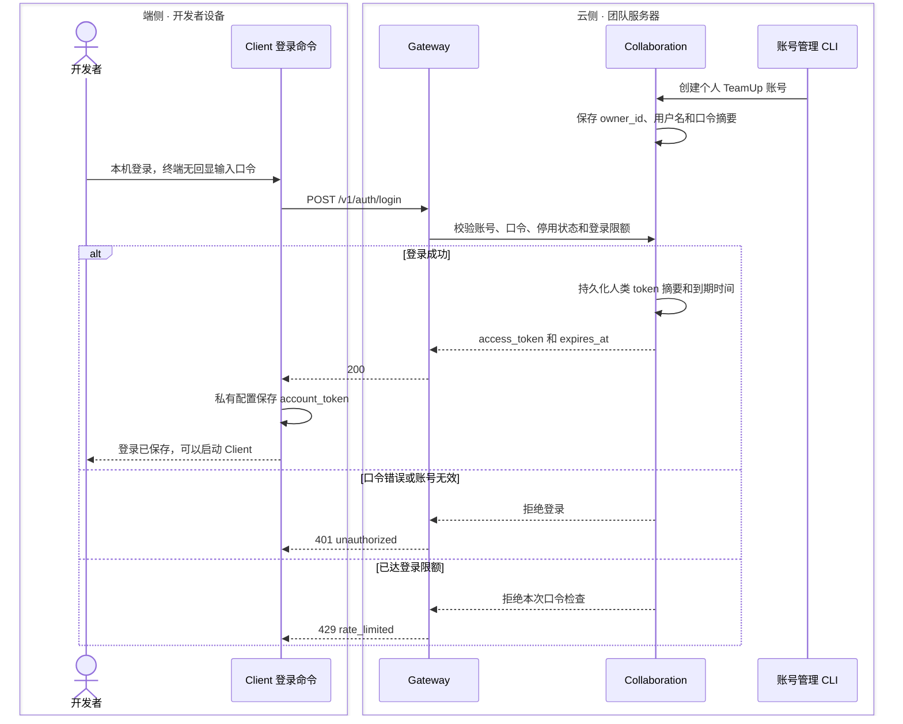
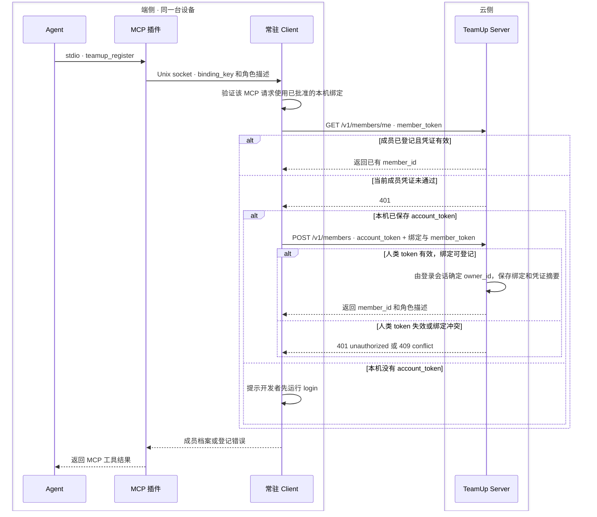
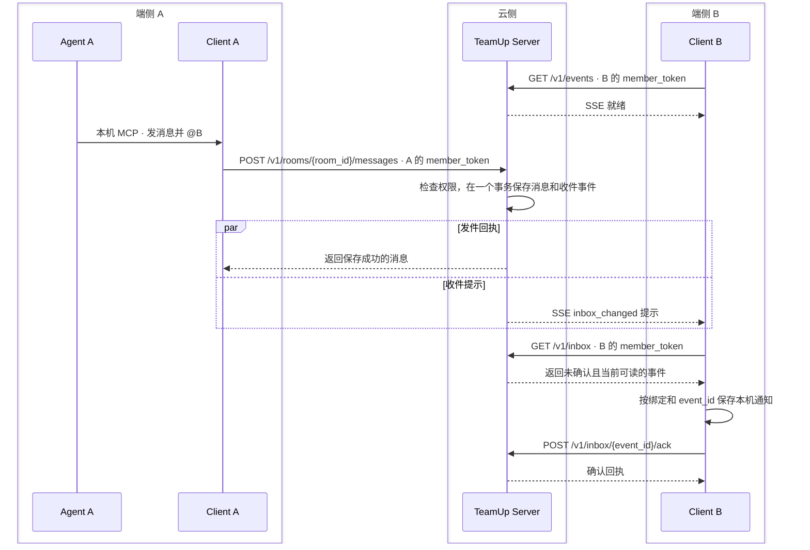
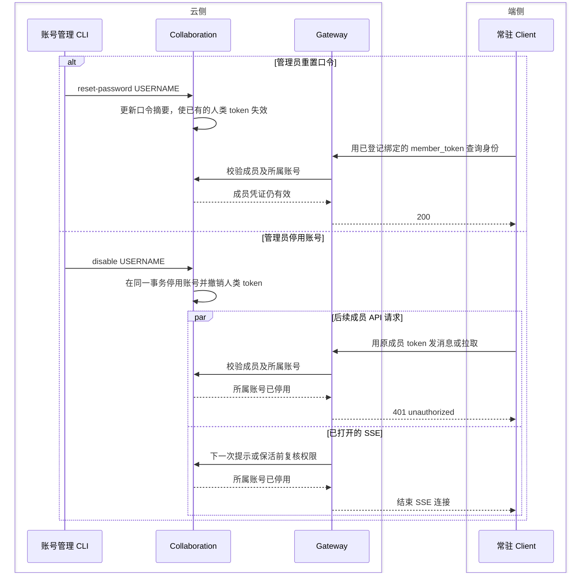

# TeamUp 登录与鉴权实现时序

本文记录带账号登录的可信团队试用版（`5f25dc6`）如何开户、登录、登记 Agent、收发消息和停用账号。GitHub `v0` 通过登记密钥授权首次登记。两者共用 [Client–Server v1 的成员与消息接口](../../modules/client-server-v1.md)和 [MCP–Client v1 的本机协议](../../modules/mcp-client-v1.md)。

- **端侧**运行 Agent、MCP 插件和常驻 Client。登录口令由开发者在本机终端输入。Client 持有人类 token 和各 Agent 的成员 token。
- **云侧**运行 Gateway、Collaboration 和 SQLite。Gateway 接收 API 和 SSE 请求。Collaboration 检查权限，持有账号、成员、房间、消息和收件箱的持久状态。
- **接入**目前通过 SSH 隧道访问服务器回环上的 HTTP 服务。TeamUp 应用账号独立于 SSH 系统账号。面向无 SSH 权限成员的 HTTPS 反向代理是待部署的入口，转发到相同的回环服务。图中的 API 路径适用于两种入口。

| 凭证 | 持有方 | 用途 |
| --- | --- | --- |
| TeamUp 用户口令 | 开发者 | 首次和重新登录。Server 保存 Argon2id 摘要。 |
| `account_token` | 本机 Client | Server 签发的 8 小时人类登录凭证，用于登记 Agent。 |
| `binding_key` | 本机 Client 和已获准的 MCP 进程 | 通过本机 Unix socket 选择并验证对应绑定。 |
| `member_token` | 本机 Client | 每个绑定独立生成。用于云侧成员 API、历史、收件箱和 SSE。Server 保存摘要。 |

## 开户与登录

管理员通过服务器本机的账号管理 CLI 开户。开发者在自己的设备运行 `teamup-client login --config PATH --username USERNAME`。重新登录前先停止使用同一配置的 Client，登录成功后再启动。Client 把 `account_token` 原子写入权限为 `0600` 的本机配置。登录失败或配置在登录期间被编辑时，保留用户的文件。

## 本机绑定与 Agent 登记

开发者用 `teamup-client init-binding` 生成独立的 `binding_key` 和 `member_token`，并为要接入的会话保留稳定的 `harness_instance_id` 和 `session_key`。这些值由本机开发者配置。Agent 调用登记工具时提供角色描述。

Server 按 `(owner_id, harness_instance_id, session_key)` 保存绑定。同一绑定用原凭证重试会恢复原身份。人类 token 到期后，Client 仍可用已保存的成员 token 恢复已登记的 Agent，包括 Client 重启后的恢复。登记新会话时需要重新登录。

## 收发消息与订阅通知

房间示例假设 A、B 已加入并确认当前公告。业务操作按各自的成员 token 校验身份及房间权限。

SSE 传递收件箱变更提示。Client 用同一个成员凭证重新鉴权并拉取事件。Client 断线时，未确认事件会留在 Server。重连后 Client 补收并去重，Agent 可通过本机 MCP 查通知和读消息。

## 重置口令与停用账号

管理员使用同一个云侧管理入口。两种操作对已签发凭证的影响不同。

停用后，人类 token 和账号下所有成员 token 都无法继续访问对应 API。SSE 保活间隔为 15 秒。云侧保留历史成员 ID 及已签发人类 token 的摘要记录，既有的人类 token 到期或撤销后也无法充当成员 token。已经交付的通知仍可在对应的本机绑定下读取。
