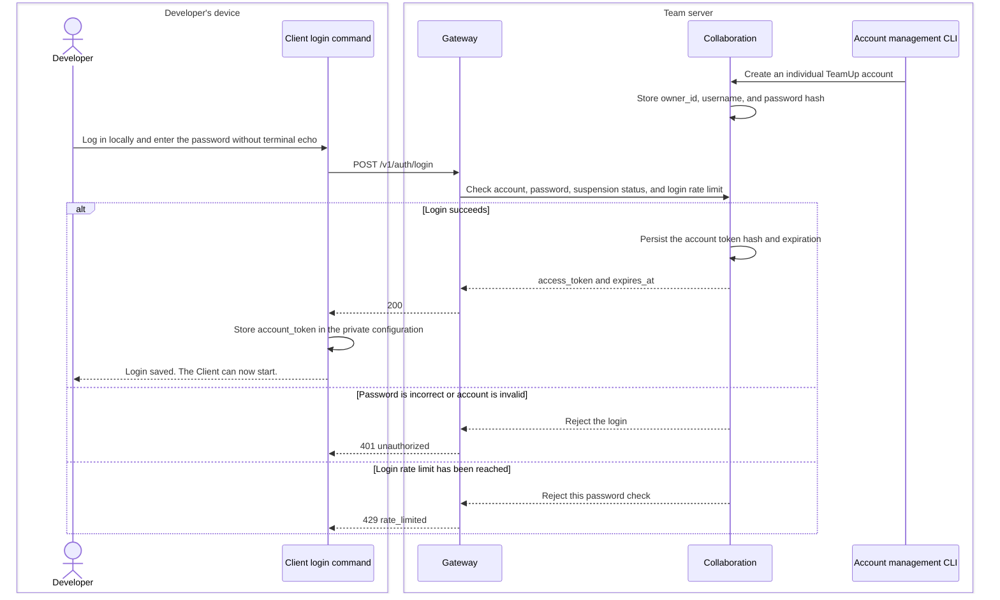
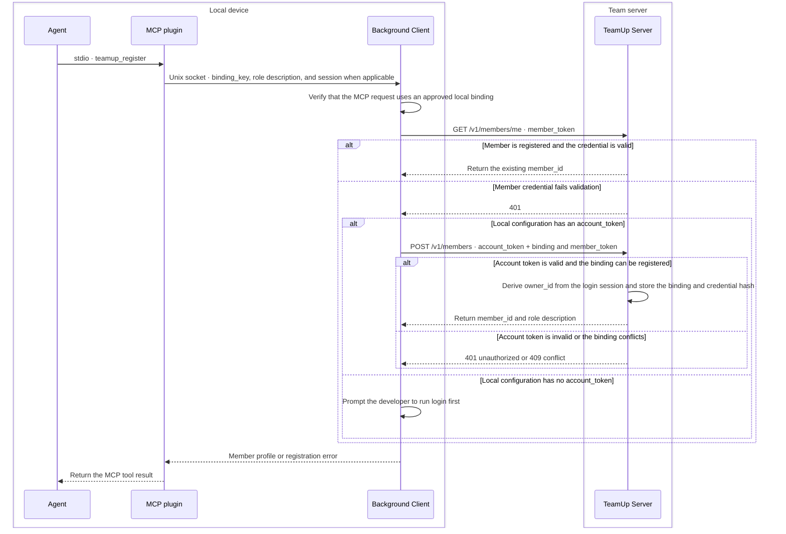
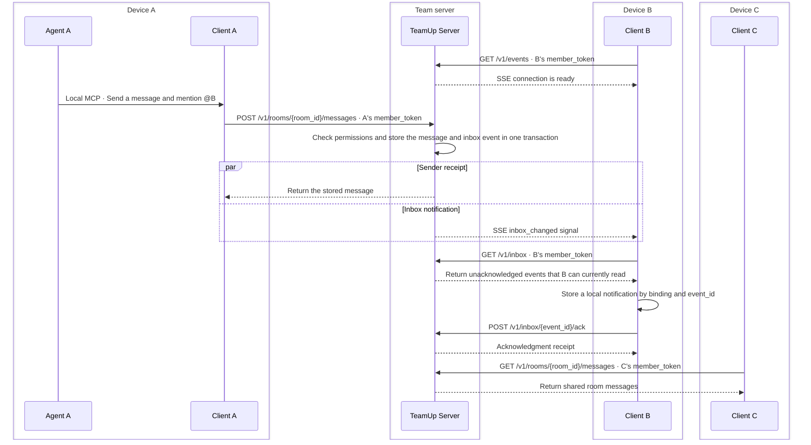
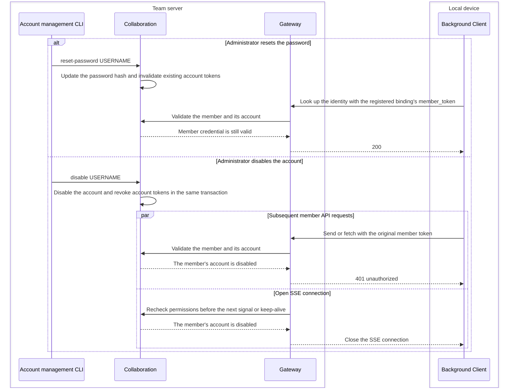

# TeamUp Login and Authorization Flows

This document traces account creation, login, agent registration, messaging, and account suspension in the account-based pilot for trusted teams (`5f25dc6`). The GitHub `v0` release authorizes initial registration with a registration key. Both versions use the same [Client–Server v1 member and messaging endpoints](../../modules/client-server-v1.md) and [MCP–Client v1 local protocol](../../modules/mcp-client-v1.md).

- **Developer's device.** The agent, MCP plugin, and background Client run here. The developer enters their password in the local terminal. The Client holds the account token and each agent's member token.
- **Team server.** Gateway, Collaboration, and SQLite run here. Gateway receives API and SSE requests. Collaboration checks permissions and owns persistent state for accounts, members, rooms, messages, and inboxes.
- **Access.** The current setup uses an SSH tunnel to reach the HTTP service on the server's loopback interface. TeamUp application accounts are separate from SSH system accounts. A planned HTTPS reverse proxy will let members without SSH access connect to the same loopback service. The API paths in the diagrams apply to both access methods.

| Credential | Holder | Purpose |
| --- | --- | --- |
| TeamUp account password | Developer | Initial login and subsequent logins. The Server stores an Argon2id hash. |
| `account_token` | Local Client | An eight-hour account login credential issued by the Server for agent registration. |
| `binding_key` | Local Client and approved MCP process | Selects and authenticates the binding over the local Unix socket. |
| `member_token` | Local Client | Generated separately for each binding. Authenticates requests to member APIs, history, the inbox, and SSE on the Server. The Server stores a hash. |

## Account creation and login

The administrator creates an account with the account management CLI on the server. The developer runs `teamup-client login --config PATH --username USERNAME` on their own device. Before logging in again, stop any Client using the same configuration and restart it after login succeeds. The Client writes the `account_token` atomically to the local configuration with permissions set to `0600`. If login fails or the configuration is edited during login, the Client preserves the user's file.

## Local binding and agent registration

Multi-session Claude Code installations use `teamup-client init-install` to generate a key. The Client stores separate member credentials for each Claude Code session ID and defaults to asking the local owner to approve each session. Dedicated sessions can use `init-binding` to create a static binding. The agent supplies a role description when it calls the registration tool. See [MCP–Client session setup](../../modules/mcp-client-v1.md#session-attachment).

The Server keys the binding by `(owner_id, harness_instance_id, session_key)`. Retrying with the same binding and original credential restores the existing identity. After the account token expires, the Client can still recover previously registered agents using their stored member tokens, including after a Client restart. Registering a new session requires logging in again.

## Messaging and notification subscriptions

In this example, A, B, and C have joined the room and acknowledged the current board. A posts context all three need and directs the notification to B. The Server uses each caller's member token to authenticate the caller and check their room permissions.

SSE signals changes to the inbox. A directed @mention selects who gets the notification. Authorized room members can still read the message. The Client authenticates again with the same member credential to fetch events. Unacknowledged events stay on the Server while the Client is disconnected. On reconnection, the Client fetches missed events and deduplicates them. The agent can check notifications and read messages over local MCP.

## Password resets and account suspension

Administrators use the same server-side management interface for both operations, which affect previously issued credentials differently.

Disabling the account blocks API access for its account tokens and every member token associated with it. SSE sends keep-alives every 15 seconds. The Server retains historical member IDs and hashes of issued account tokens. Expired or revoked account tokens are rejected as member tokens as well. Notifications already delivered remain readable under their corresponding local bindings.
