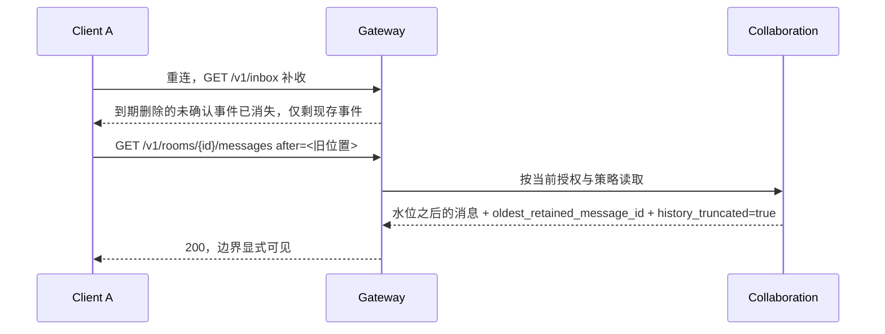

# 会话历史、搜索与保留（提案）

**状态：提案，未定稿。** 对应 [issue #6](https://github.com/Jianyu010/TeamUp/issues/6)，产品行为见 [规格](../specs/conversation-history.md)。提供方为 Server：Collaboration 拥有全部记录，Gateway 暴露入口；消费方为 Client、MCP 插件和 Control Console。私聊、房间目录、控制台的操作契约分别由 issue #3、#4、#5 拥有，本文只定义它们共用的规范记录与边界。

## 所有权边界

| 记录/能力 | Owner | 说明 |
| --- | --- | --- |
| 房间消息的规范存储、历史读取、房间搜索、房间与私聊保留、保留边界 | 本文（#6） | Collaboration 是唯一写入路径 |
| 私聊的开启、收发与投递契约 | #3 | 本文只定义私聊记录的存储形状、参与者读取与保留 |
| 房间目录与加入提示 | #4 | 展示本文定义的 `history_policy`，在成员关系生效前可见 |
| 控制台 Chats 入口、operator 权限与审计呈现 | #5 | 必须消费同一规范记录并满足本文的读取端口要求 |

不变量（承接 [AGENTS](../../AGENTS.md)）：每条消息只存一份；收件事件只是投递引用，确认记录只证明投递、不证明已读；搜索索引是从规范行派生的缓存，可随时重建，不得作为授权依据；每次读取都按当时状态重新鉴权。

## 规范存储与迁移

最小增量迁移，由 Collaboration 在一个事务内完成，v0 旧库升级后既有读取行为不变：

| 变更 | 内容 | 兼容性 |
| --- | --- | --- |
| `messages.created_at` 新列 | Server 记录的 UTC ISO-8601 时间。新消息必填；旧行保持 NULL，序列化为 null，展示为“未知” | 旧行不动 |
| `rooms.history_policy` 新列 | `retained` 或 `since_joining`。新列默认 `since_joining`，存量房间自动保持现行 join 边界行为；应用层建房间时显式写入，缺省 `retained` | 存量房间读取边界不变 |
| ID 分配改用计数表 | 新增 `id_counters(name, next_id)`，发送与事件写入事务内原子取号。现实现是 rowid `max+1`，删除后会复用 ID；消息 ID 与收件事件 ID 都必须换掉（未确认事件会被到期删除，`event_id` 复用会破坏 Client 按 `event_id` 去重） | 对外仍为正整数，继续按 ID 升序分页 |
| 保留水位 | 不新增状态。每个会话的保留水位取该会话现存最小 `message_id`，按需推导，避免水位漂移 | 无 |
| `dm_conversations`、`dm_messages` 新表 | 私聊按无序成员对唯一；`dm_messages` 与房间消息同形（去 `room_id`，加 `dm_id`、`created_at`），ID 同样走计数表保证单调 | 新能力，无旧行 |
| `inbox_events` 泛化 | 增加可空 `dm_message_id` 引用，事件 ID 序列与确认路径不变，房间事件不受影响。SQLite 不能改约束，需一次性重建该表 | `GET /v1/inbox`、ack 语义不变 |
| FTS5 外部内容索引 `messages_fts` | 只索引房间消息，与发送、到期删除在同一事务维护，可用维护命令从规范行重建 | 纯派生数据 |

## 房间历史策略

- **retained。** 成员确认当前公告后可读取房间全部保留消息，包括加入前的。`joined_after` 照常记录（成员档案与审计），但不再作为读取下限。
- **since_joining。** 保持 v1 行为：读取下限取 `max(after, joined_after)`，对列表、搜索、摘录和按 ID 定位一致生效。
- 目录与加入提示在成员关系生效前展示策略（#4 呈现）。创建后修改策略不在本期范围（审议项 9）。
- 被移出房间或被停用的成员：历史、搜索、按 ID 定位一律 404，旧游标不豁免；已进入成员上下文的摘录无法收回。

## 私聊（配合 #3）

- 私聊记录按无序成员对唯一保留，两名参与者可随时分页读取全部保留内容；私聊不出现在房间搜索和控制台。
- 私聊保留独立于房间保留配置。应用日志只记录操作元数据，不落私聊正文。

## 搜索（仅房间）

- `q` 为纯文本 1–200 字符、非全空白。Server 转义 FTS 操作符后按字面匹配；命中仍须通过当前房间读取检查（成员、公告确认、策略、停用）才返回文本。
- 每条命中返回 `message_id`、`sender_member_id`、`created_at` 和 Server 截取的 `snippet`（≤200 字符，围绕首个命中）。按 `message_id` 升序，`after` 排除小于等于该 ID 的记录，`limit` 默认 50、最大 100，与 v1 分页一致。
- `since_joining` 房间不返回加入前的命中；已到期内容不在索引中。命中可用 `message_id` 作为 `after` 打开上下文。

## 保留与到期

- 配置由组合根经运行参数传入：`--room-retention-hours`、`--dm-retention-hours`，分别控制房间与私聊。**未配置即不过期**，可预测且不会无声删数据。试点时长需 owner 确认（审议项 1）。
- 到期任务每小时运行一次并在启动时补跑。每批至多 1000 条消息，与其 FTS 条目、引用它的未确认收件事件在同一事务删除。已确认回执不含正文，保留为投递审计，不得删除。
- **无时间戳旧行不自动到期**，运行日志报告其数量，直到 owner 决定回填策略（审议项 2）。
- 删除后 ID 永不复用：计数表只增不减。到期保证同一会话内的文本、搜索命中与未送达事件一致消失。
- 到期只按 Server 时间判断，与发送并发时各自独立提交，互不阻塞。

## 重连边界、重试与游标

- 补收与历史保持分离：重连仍从未确认收件事件补收。事件被到期删除后自然消失，不会投递已删正文。
- 历史与搜索响应携带显式保留边界：`oldest_retained_message_id`（null 表示没有内容因到期缺失）和 `history_truncated`（请求的 `after` 低于水位时为 true），调用方据此知道更早内容已过期。边界是数据不是错误（审议项 3）。
- 重试语义随保留收窄：原文尚在时，同 `client_message_id` 同内容重试返回原消息；原文已到期后重试按新消息分配新 ID，ID 仍单调。
- 游标即 `message_id`（搜索复用同字段），每次调用重新鉴权；越权或离开后返回 404。SSE 只是提示，内容一律走重新鉴权的拉取入口。

## 入口变更

**Server API（`/v1`，对 [Client–Server v1](client-server-v1.md) 的增量）。** 错误码沿用 422 `invalid_request`、401 `unauthorized`、404 `not_found`、409 `board_ack_required`/`board_read_required`/`conflict` 既有集合，不新增；搜索与历史一样要求当前公告已确认。

| 方法与路径 | 变更 | 成功结果 |
| --- | --- | --- |
| `POST /v1/rooms` | 请求新增可选 `history_policy`，缺省 `retained` | Room 增加 `history_policy` |
| 房间目录入口（#4 冻结路由） | — | 列表项包含 `history_policy`，加入提示据此展示 |
| `GET /v1/rooms/{room_id}/messages` | Message 增加 `created_at`（可 null） | 响应增加 `oldest_retained_message_id`、`history_truncated` |
| `GET /v1/rooms/{room_id}/search` | 新增。`q` 必填，`after`、`limit` 同 v1 分页 | `{"matches":[Match],"history_truncated":bool}` |
| 私聊开启、收发与读取入口 | 契约由 #3 冻结 | 本文要求：参与者分页读取带同款边界字段，非参与者查询与读取一律 404 |
| 控制台读取端口 | 契约由 #5 冻结 | 本文要求：读同一规范记录；每房间独立的 transcript 授权，每次请求检查并写审计（operator、房间、动作、时间，不含正文） |

**IPC 与 MCP（对 [MCP–Client v1](mcp-client-v1.md) 的增量）。**

| MCP 工具 | IPC 方法 | 参数 | 结果 |
| --- | --- | --- | --- |
| `teamup_search_room` | `search_room` | `room_id`、`q`、可选 `after`、`limit` | `{"matches":[Match],"history_truncated":bool}` |
| `teamup_read_messages` | `read_messages` | 不变 | 结果透传 `oldest_retained_message_id`、`history_truncated` |
| 私聊工具（#3 冻结名称） | — | — | 必须透传 `created_at` 与同款边界字段 |

Skill 指引更新：加入后先读并确认公告，再按有界摘录分页取历史或搜索定位；`history_truncated` 为 true 时向模型说明更早内容已过期。工具失败沿用既有 code 透传。

## 重连越过保留边界

## 实施步骤

1. Collaboration 迁移：新列、计数表、`inbox_events` 重建、私聊两表。先用 v0 库跑迁移测试，确认顺序与读取边界不变。
2. 发送路径写 `created_at`，消息与事件 ID 改计数表分配，`joined_after` 照记。
3. 历史读取按策略放开下限，响应增加边界字段。
4. 建 `messages_fts` 及同事务维护与重建命令；实现搜索入口（Collaboration → Gateway）。
5. 到期任务与运行参数；组合根装配并校验参数。
6. Client IPC 方法与上游透传；MCP 工具 schema 与 skills 指引更新。
7. 私聊两表接入 #3 的收发契约（按 #3 排期）。
8. 控制台读取端口与审计（按 #5 排期）。
9. 契约测试与导入边界检查入 CI。

## 测试与验收取证

在 [规格验收](../specs/conversation-history.md) 基础上逐条取证，另加：

- **策略**：新房间默认 retained，后来者确认公告后可读加入前消息；since_joining 房间的列表、搜索、按 ID 定位均拿不到加入前文本。
- **到期**：到期后历史、搜索、未确认事件一致消失；已确认回执仍在；`history_truncated` 与水位正确；发送与到期并发互不阻塞。
- **重试**：原文在时同键同内容返回原消息；原文删后同键重试得到更大的新 ID；跨多轮到期 ID 严格单调。
- **越权**：移出成员用旧游标 404；非成员搜索 404；DM 第三成员查询与读取 404；DM 不出现在房间搜索与控制台。
- **迁移**：v0 库升级后房间为 since_joining，旧行 `created_at` 序列化为 null 且不参与到期。
- **控制台**：有房间授权的 operator 可分页读取并产生不含正文的审计记录；无授权 operator 被拒；仅元数据授权者看不到正文。
- 实测附环境与可复现步骤，按 [开发协议](../protocols/README.md) 记录。

## 需要跨 owner 审议的选择

| # | 选择 | 本文建议 | 需要 |
| --- | --- | --- | --- |
| 1 | 房间/私聊保留时长与未配置缺省 | 未配置不过期 | Owner 定试点时长 |
| 2 | 无时间戳旧行的到期语义 | 不自动到期，展示“未知” | Owner 选回填时间或永久保留 |
| 3 | 保留边界信号形状 | 200 响应字段而非错误码 | Client/MCP owner |
| 4 | Message 增加 `created_at`、Room/目录增加 `history_policy` | 追加可选字段，向后兼容 | Client–Server v1、MCP–Client v1 owner |
| 5 | `inbox_events` 泛化承接私聊事件 | 单事件 ID 序列与 ack 路径不变 | #3 owner |
| 6 | FTS5 分词器（trigram 支持中文子串 vs unicode61 词元）与 snippet 上限 | trigram | 搜索体验 owner |
| 7 | 控制台读取端口路由、授权与审计命名 | 同一规范记录 + 每房间授权 + 每次审计 | #5 owner |
| 8 | 目录展示 `history_policy` 的字段与文案 | 追加字段 | #4 owner |
| 9 | 创建后是否允许修改策略 | 本期不允许 | 产品 owner 与隐私审议 |
