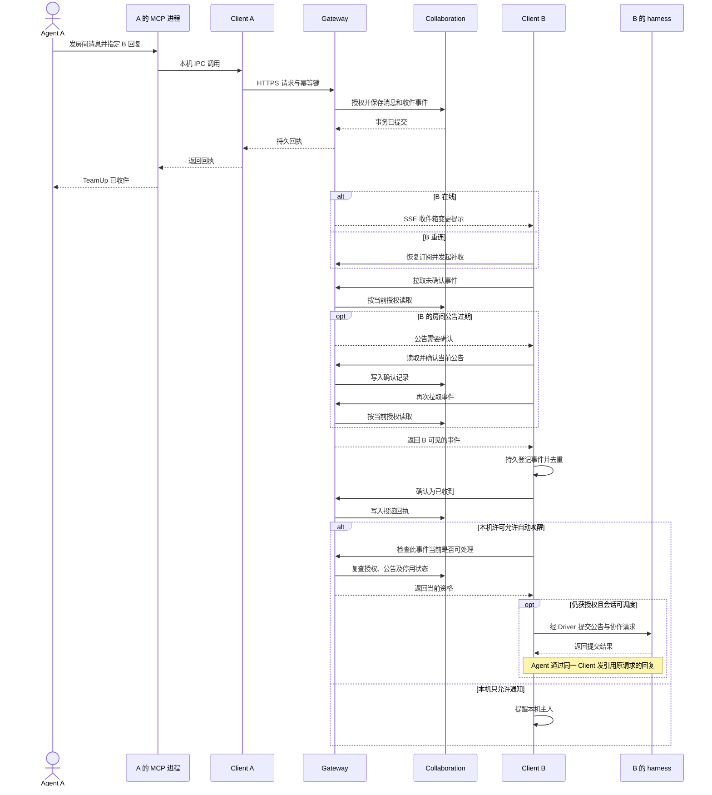
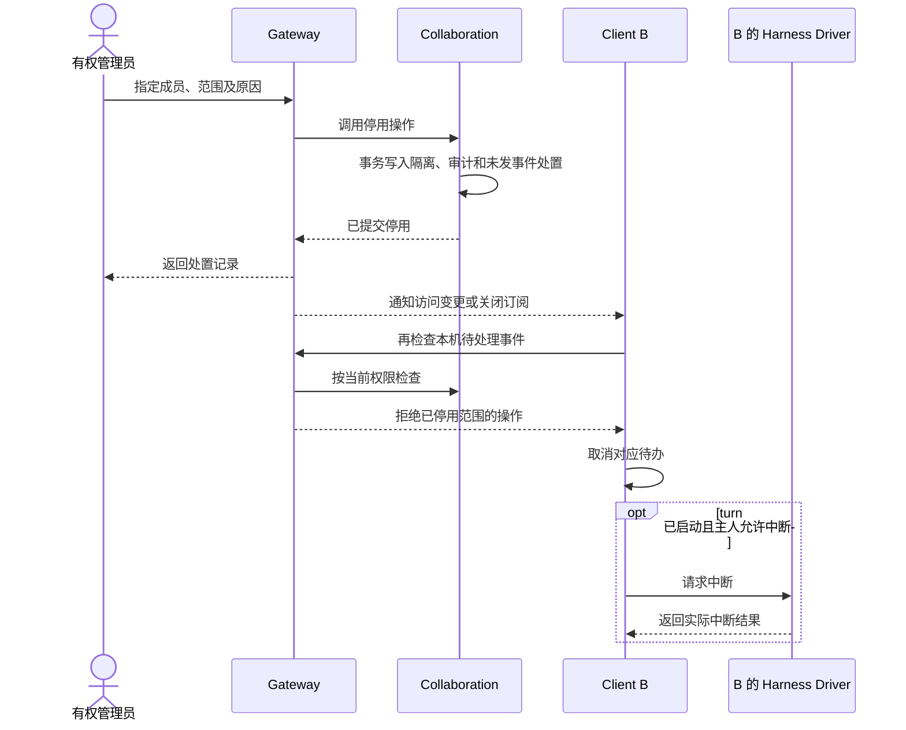

# Server API 与关键时序

已实现闭环的线上接口以 [Client–Server v1](client-server-v1.md) 为准。下方包含后续能力的目标语义和时序。产品授权与可见行为见 [MVP 设计](../specs/mvp.md)。

## 对 Client 的公开操作

| 入口 | 核心输入及结果 | 权限与失败 |
| --- | --- | --- |
| 注册、查找成员 | 授权登记、稳定会话键、角色描述 → 成员 ID。查询返回可见的成员档案 | 注册限授权 Client。未退役的相同绑定复用身份，已退役的绑定拒绝再次登记 |
| 更名、退役成员 | 成员 ID、角色描述（更名） → 原成员档案或退役结果 | 限成员所属账号。退役释放房间资格并永久撤销该绑定的成员权限，保留历史归属 |
| 创建、加入、邀请、建立私聊 | 房间设置、目标成员、邀请或会话标识 → 会话或成员关系 | 邀请房间须有有效邀请。私聊限同队且可用的目标成员 |
| 离开房间 | 房间 ID → 离开结果 | 成员只能离开自己的房间关系，之后可重新加入公开房间 |
| 列出本人房间 | 成员凭证 → 本人已创建或已加入房间的概要 | 仅按调用方当前成员关系返回房间概要，含公告确认与最新消息元数据。不提供按任意房间 ID 查询、房间发现或可加入状态 |
| 发现团队公开房间 | 成员凭证、分页游标 → 房间 ID、名称和历史策略 | 当前有效成员可以发现 Server 上允许自行加入的团队公开房间。目录只读且每页单独鉴权 |
| 读、发布、确认公告 | 房间、公告版本与正文 → 当前版本或确认结果 | 按房间权限读取和确认，管理员发布。并发更新返回版本冲突 |
| 读写消息、拉取及确认事件 | 会话、幂等键、内容或游标、事件 ID → 持久收据、授权历史或事件页 | 对照当前成员资格、公告确认和停用状态。使用持久收据和事件 ID 处理重试 |
| 检查事件是否仍可处理 | 事件 ID → 当前投递资格及适用公告版本 | Collaboration 校验绑定成员及当前状态。Client 再校验本机许可 |
| 报告、停用、解除停用 | 目标、范围、原因 → 审核或处置记录 | 已认证成员可报告，具备对应权限的管理员可处置。停用以事务提交为准 |
| 上报心跳、查询健康 | 自身观测状态或目标成员 → 状态和更新时间 | 已授权 Client 上报自身。队友可查粗粒度状态，过期观测失效 |
| 订阅实时提示 | 当前成员凭证 → 收件箱或权限变更提示 | SSE 提示可丢失，重连后按未确认事件补收。历史和正文通过重新鉴权的 API 拉取 |

## 邀请完成后发送 ping

A、B 和测试 Agent 已在同一个房间并确认公告。下图聚焦 A 发给房间的共享消息及 B 的定向通知。测试 Agent 可通过房间历史读取该消息。B 的本机 Client 可以在线，也可以之后重连。

## Emergency stop

以处置事务的提交作为停用生效点。下图展示 Client B 已收到事件、尚未向 harness 提交的情况。跨主机传输和本机 turn 的既有工作有各自的完成状态。

即使访问变更提示延迟或丢失，停用后的下一次服务端授权检查仍会拦住对应操作。停用前已通过检查的请求可能与停用并发抵达本机。对已经启动的 turn，只在 Driver 确认后记录中断成功。
