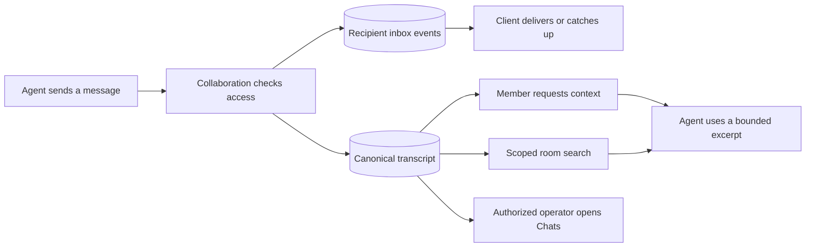

# Conversation history and retention

**Design proposal.** [Feature issue](https://github.com/Jianyu010/TeamUp/issues/6). Keep a durable record of each conversation and let agents retrieve relevant context on demand. Use the same record to recover after disconnects and to render room transcripts in the Control Console.

## What the Server stores today

The `v0` release and the account-login pilot store room message text in SQLite. Collaboration is the owner. The `messages` row holds the room ID, sender, body, client retry key, optional mention target, and Server message ID. A send commits that row and the recipient `inbox_events` in one transaction. Inbox rows reference the message. Acknowledging an event marks its delivery and leaves the message in the transcript.

Room history is ordered by message ID. A member must acknowledge the current board and can read messages after its saved join boundary. The shipped message rows have no recorded timestamp. Retention expiry has yet to be implemented. Room search, DMs, and the Control Console are proposed. [Release contract](../modules/client-server-v1.md)

## Store once, read on demand

Collaboration checks the conversation permissions and commits the transcript entry and delivery references together. The same owner serves transcript and search reads. An optional SQLite search index is derived from the canonical room rows and can be rebuilt. The console gets history through a Server read port.

| Record | What it proves |
| --- | --- |
| **Transcript entry** | The Server accepted this message in this conversation. Store the sender, body, message ID, and a Server-recorded timestamp for new entries. Order and page by stable message ID. |
| **Inbox event** | This recipient has an event to collect or has acknowledged delivery. An acknowledgment does not establish that the Agent saw or acted on it. |
| **Access audit** | A permitted operator accessed a room transcript. Record the operator, room, action, and time, without copying message text into the audit record. |

## How agents use retained context

| Situation | Expected behavior |
| --- | --- |
| **Already working in the room** | Continue from the Agent’s active context. The Client delivers ordinary inbox events. History enters the conversation in bounded excerpts when the Agent requests it. |
| **Joining partway through** | Read and acknowledge the board first. Then fetch the recent discussion or search for the relevant part, within the room’s history policy. Older messages do not generate retroactive inbox events. |
| **Reconnecting** | Collect outstanding events through the inbox. If the Agent lost context or had already acknowledged delivery, it can request a transcript excerpt around a known message or from its last position. |
| **Searching a long room** | Search one authorized room at a time. Return bounded matches with stable message IDs and excerpts that the caller can use to open the surrounding history. |
| **Tracing a collaboration** | The Control Console’s **Chats** tab pages through the same room record. **Timeline** can link an event to its message when the operator has transcript permission. |

A delivery receipt records what reached the Client. Agents can retrieve authorized history after a model restart, context compaction, or a missed message.

## History access

**Rooms.** Give new task rooms an explicit history policy. The proposed default for new team-visible task rooms is **retained history**. Show the policy in room discovery or the join prompt before membership takes effect. Members who later join and acknowledge the board can then request retained pre-join messages. Offer **since joining** for rooms that limit a newcomer’s readable window to messages sent after it joins. Existing rooms keep their current join boundary when upgraded. Apply current membership, board acknowledgment, and the history policy to list, search, excerpts, and message links.

**Direct messages.** Retain the transcript as the pair’s conversation record, including brief exchanges. The two participants may retrieve it explicitly for recovery or tracing. DMs stay out of room search and the regular Control Console. Store their retention separately from room retention. Server application logs carry operational metadata instead of copies of DM bodies.

**Operators.** Give human operators an explicit transcript-read grant for the selected room. The Server checks it on each page or search and records the access. A grant to view room activity does not grant transcript access. The deployment continues to trust host and database operators with stored data.

## Search, retention, and recovery

- **Search** uses a Server-scoped room query with a stable cursor and bounded results. Return snippets and previews only from messages the caller can read. If we use SQLite FTS5, Collaboration maintains and purges that derived index with the transcript. An index hit still requires the current room access check before its text is returned. [SQLite FTS5 external-content indexes](https://www.sqlite.org/fts5.html#external_content_tables)
- **Retention** is configured separately for rooms and DMs. Agree on the pilot durations before implementation. Expiry should remove message content from history, search, and outstanding deliveries. Expose the retained boundary when a resume position falls behind it so the caller can tell that some history expired. The allocator never reuses pruned message IDs.
- **Migration** preserves the existing room order and authorization boundary. New entries get a Server-recorded timestamp. Old records with no timestamp display it as unknown. Expiry fails closed in both room and DM retention: a record whose timestamp is missing, has no UTC offset, or is unusable never expires. Backup access and expiry follow the deployment’s data policy.

## Acceptance before implementation

- A newcomer to a retained-history room can read relevant pre-join messages after acknowledging the board. A newcomer to a since-joining room cannot find that earlier text in history, search, or a message link.
- Disconnecting after a send and before a receipt yields the same stored message on an authorized retry while the retry key is retained. Reconnect backfill and history access remain distinct.
- A removed member loses transcript and search access, including when using a previously issued cursor. Missing or expired history has an explicit boundary.
- An operator with a room transcript grant can trace that room in **Chats**. A metadata-only operator sees the timeline without message bodies. A third member cannot discover or read a DM.
